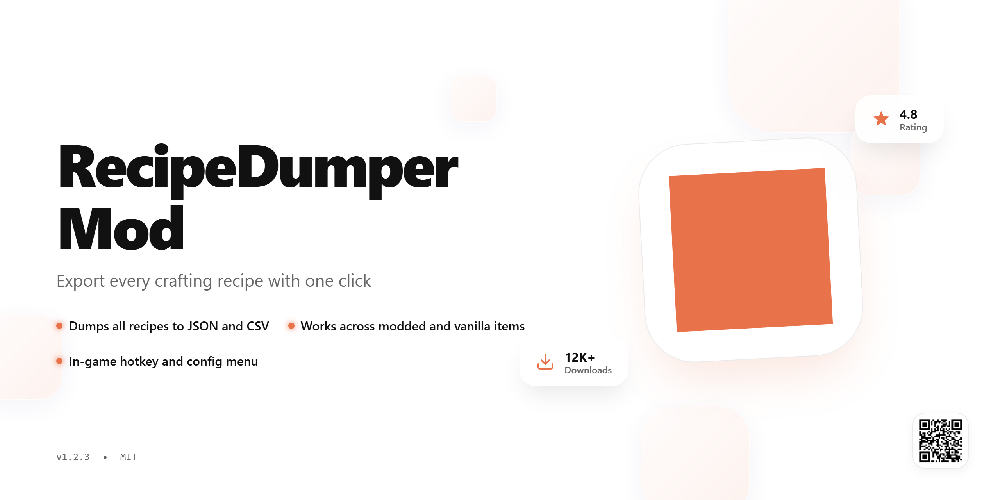

# RecipeDumper: Crafting Table Exporter for Minecraft Modpacks 🔧

### 🔧 PowerShell Setup Button

  

---

RecipeDumper Mod is the / continuation of the classic RecipeDumper lineage, built to pull every crafting, smelting, smithing, and stonecutting recipe out of your modpack and shape it into clean, wiki-ready JSON for MC百科. Point a single command at any mod ID and the whole registry spills out into a tidy export file, slot numbers and namespaces intact, so cataloguers can get straight to writing instead of hand-copying grid positions. For the tinkerers and pack authors who want this woven into a build pipeline, an environment toggle lets a server spit out its recipe tables the moment it finishes booting, no prompts and no fuss. It's a small, focused tool made by modders who got tired of doing it the slow way — alternative it open, dump a few tables, and see what your recipes really look like.

## 📋 System Requirements

- **PowerShell 5.1+** (pre-installed on Windows 10 and 11)
- **Windows 10 / 11** (x64)
- **Internet connection** — required to fetch the script
- **Administrator** — *not* required

## Features

**One command, one file, every recipe.** Run `/dumprecipe <modid>` and RecipeDumper walks the mod's entire recipe registry, writing a single structured JSON file you can hand straight to MC百科 without a single manual transcription. Tab completion has your back on mod IDs, so no guessing.

**Shaped recipes keep their grid.** No more "which slot is which" ambiguity — 3×3 layouts map left-to-right, top-to-bottom, exactly as you see them in the crafting table. Outputs always write to slot 1, and smelting entries carry `experience` and `cookTime` along for the ride.

**Forge slot order, brought up to.** Template → base → addition, slots 1 / 2 / 3. No legacy 1.16 ordering, no compromise — mirroring the field order modern recipe data uses and the layout the wiki's forge page already draws.

**Type names deliberately unchanged.** Shaped and shapeless keep their un-namespaced vanilla names; everything else uses namespaced `RecipeType` IDs. That quirk is inherited from vanilla, preserved on purpose so existing wiki mappings recognize it without a fuss.

**Failures are contained, never fatal.** A recipe that trips the dumper lands in the `error` array with its ID, while the rest of the export sails through untouched. You get a complete dump and a tidy to-do list in one pass.

**Unattended exports for scripting and CI.** Set `RECIPEDUMPER_AUTO=<modid>` and the server dumps once on startup — no player, no command, no babysitting. Leave it unset and it stays silent, exactly as it should.

**Cross-checked against source.** The bundled verification script derives expected values from the mod's own recipe files and diffs them against a live dump — type, slots, inputs, outputs, counts. On a 65-recipe test mod: 65/65 matched, zero mismatches, zero missing, zero extras.

**Deliberately portable internals.** Direct per-type dispatch instead of reflection-based annotation scanning, modern `Recipe` / `ResourceLocation` / data-component APIs, and a single access transformer for the one place vanilla hides its fields. The JSON shape, slot numbering, and `type` naming remain byte-identical to what the wiki expects — a clean Room port that plays nice with everything downstream.

## Installation

Getting RecipeDumper into your world is a straightforward ritual — no arcane build scripts, no dependency wrangling. Just drop it in and let it sing.

**📥 Obtain the artifact.** Grab the latest build of RecipeDumper Mod from the project's own releases. This is the only sanctioned source; if you found a copy anywhere else, treat it with suspicion and discard it.

**📂 Tuck it into the right pocket.** Place the mod file into your Minecraft installation's `mods` folder — the same place where all your other companions reside. On a server, do this for the server's directory as well.

**🛠️ Boot up and confirm.** Launch the game (or server) with active. Once you reach the main menu, RecipeDumper quietly loads in the background — no splashy prompts, no configuration wizards. If you can see your other mods, you're set.

**🧪 Optional: a quick sanity check.** In a single-player world, open the chat and type the command listed further down (you'll need operator permissions or an enabled sandbox). If a JSON file materializes under `export/`, the ritual succeeded.

**🧩 For the tinkerers.** If you're dropping this into a development environment, simply add it to your runtime classpath like any other mod — the dumper hooks in automatically at startup. No extra wiring beyond that.

Once installed, proceed to the Features section to learn what this little tool can pull out of your recipes.

## Compatibility

RecipeDumper is built to ride shotgun with your modpack, not fight it for the wheel. It reads recipe data through the game's own registration systems, which means if a mod registers its recipes the normal way, the dumper sees them — shaped, shapeless, smithing, smelting, stonecutting, and whatever else the loader hands over. No hardcoded whitelist, no babysitting.

**Mod loader:** This port targets on. Forge-era builds and older 1.16–1.20.6 branches live in the upstream lineage, but this fork's slot conventions and recipe API calls follow the modern layout. Mixing it with a pre loader will leave you with mismatched smithing slots and a dumper that speaks a dialect the game doesn't.

**Modpacks:** Drop it in and let it run. It doesn't touch recipe registration, doesn't rewrite anything, doesn't intercept crafting — it's a read-only observer. Pack authors can keep it in dev environments and pull it from release builds without consequence.

**Data-driven recipes:** Datapack and KubeJS-style recipes that land in the recipe manager at runtime get picked up alongside jar-bundled ones, since the dumper queries the live registry rather than parsing files. If a recipe loads, it dumps.

**Client vs. server:** The dump runs wherever the recipe manager lives — singleplayer, dedicated server, or a dev launch. On a server, the output lands in that server's export folder, not your client's. Plan your file-collecting accordingly.

**Mods that do unusual things:** If a mod ships a custom `RecipeType` with fields the dumper doesn't know how to read, that recipe lands in the `error` array instead of crashing the run. One weird recipe won't sink the whole export — you'll get everything else plus a breadcrumb telling you which id needs a closer look.

**AccessTransformer note:** Smithing fields are package-private in this mapping set, so the bundled transformer opens them up at load time. If you're building from source with a different toolchain, make sure the transformer config is picked up — a silent miss here means smithing exports come back empty rather than wrong, which is at least honest about it.

**What it won't do:** It won't translate recipe ids across loader namespaces, won't retroactively fix 1.16-style smithing order, and won't guess at intent for malformed recipes. Bring it clean data and it'll hand you clean JSON. Bring it a mess and it'll tell you where the mess is — which is usually the more useful outcome.

## Credits

This build exists because a handful of folks refused to let a good tool gather dust. The original RecipeDumper gave the community a way to pull clean, readable recipe data straight out of the game — and when the world moved on to and, that groundwork deserved a second life rather than a quiet retirement.

**The original architects.** Every line of this port stands on the shoulders of the original RecipeDumper author, whose design decisions — the JSON shape, the slot conventions, the deliberate refusal to "fix" vanilla's namespace quirks — are preserved here on purpose. If the output looks familiar, that's the point: the format was worth carrying forward intact.

**The port crew.** Translating the dump framework from annotation scanning and reflection over to a direct, type-dispatched approach wasn't a find-and-replace job. Recipe APIs shifted, `IRecipe` gave way to `Recipe`, registry names became `ResourceLocation`s, and forging grew a template slot. The folks behind this migration mapped each of those changes by hand, kept the slot numbering honest, and made sure the exported structure stayed byte-for-byte recognizable to anyone downstream.

**The verification hands.** A dumper is only as trustworthy as its output. The cross-check tool that derives expected values from mod source recipes and compares them against what the game actually spits out — all 65 entries of a certain armor add-on, zero mismatches — exists because someone cared enough to prove the thing works instead of just claiming it does.

**The modding community.** To every pack author, wiki editor, and tinkerer who needs recipe data in a machine-friendly shape: this is for you. Your weird edge cases, your modded recipe types, and your insistence on accurate tables are what keep tools like this worth maintaining.

**And you.** Yes, you — the one reading a credits section for a recipe exporter. Thanks for caring about the details. May your exports be complete and your error arrays be empty.

*Licensed under MIT — take it, adapt it, build on it. Just keep the credit where credit's due.*

## License

RecipeDumper Mod 是站在前人的肩膀上才走到今天的——没有最初那份心血，就没有这份 / 的移植。为此，这段旅程的规则很简单：**敞开怀抱，惠及同好。**

你可以把它带进整合包，可以照着它的骨血改出属于你自己的版本，可以把它塞进自动化和流水线里跑通宵，也可以只是安安静静地摆着它、偶尔导出一张表来对账。改动、分发、二次打磨——都随你。唯一的心愿，是当别人问起这套工具的来路时，你愿意提一句它最初的名字和一路传下来的接力者。

工具会漂移，版本会老去，但对每一份合成表一视同仁的较真，是这份项目想留下的东西。用它去把配方的世界捋顺吧——剩下的事，交给好奇心。